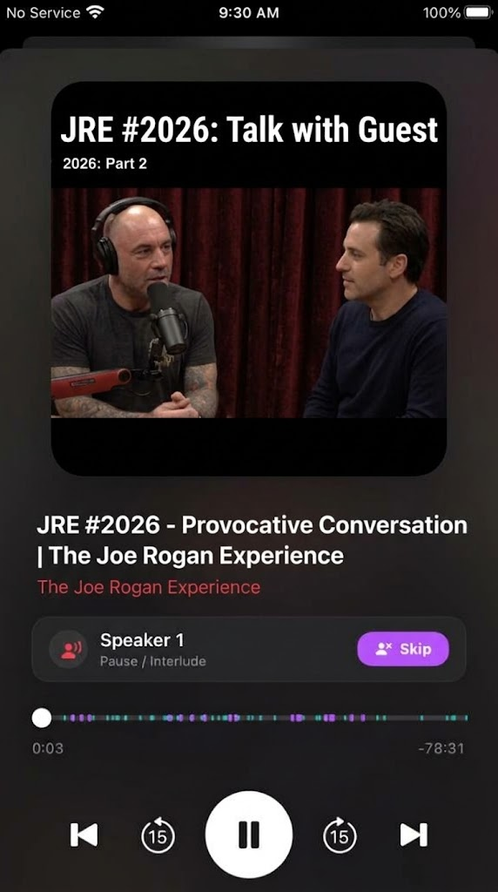
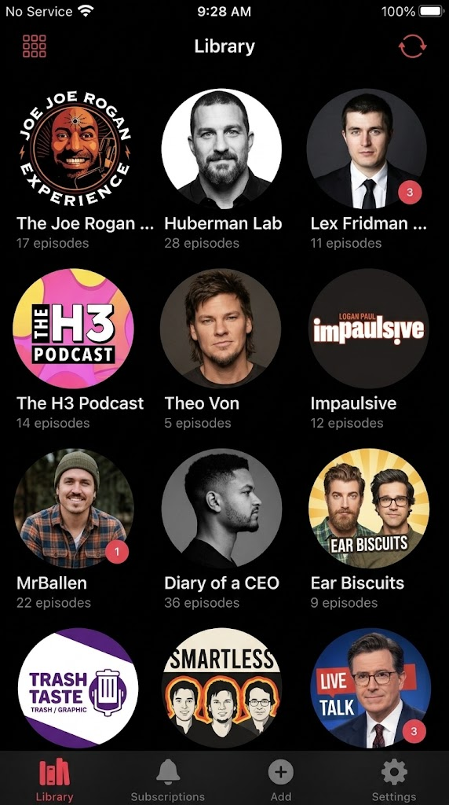
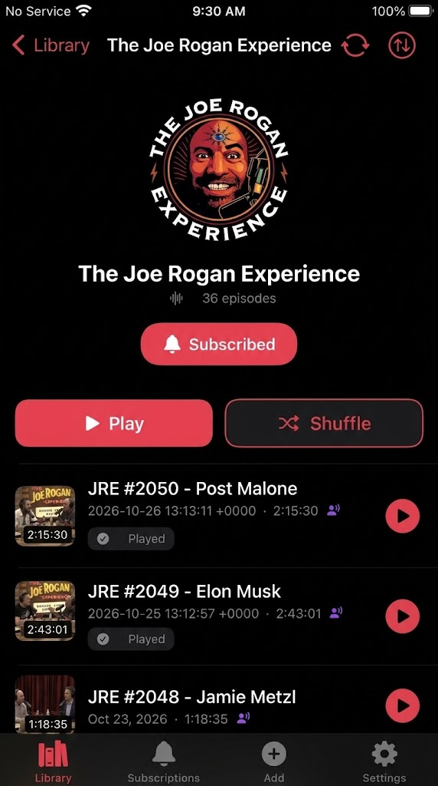
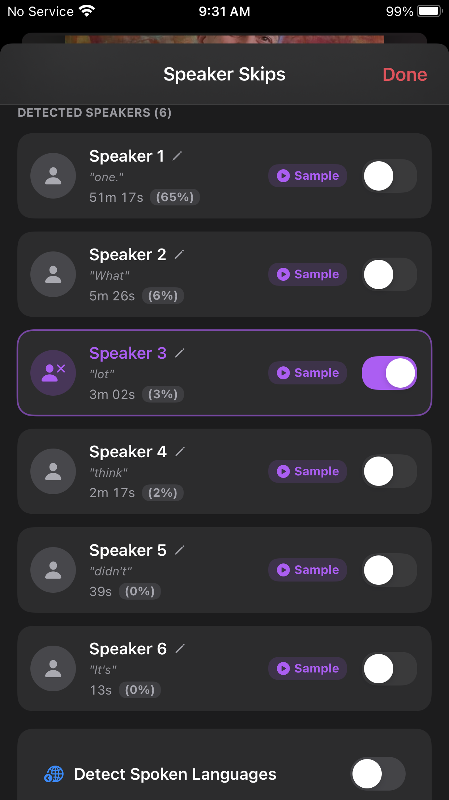
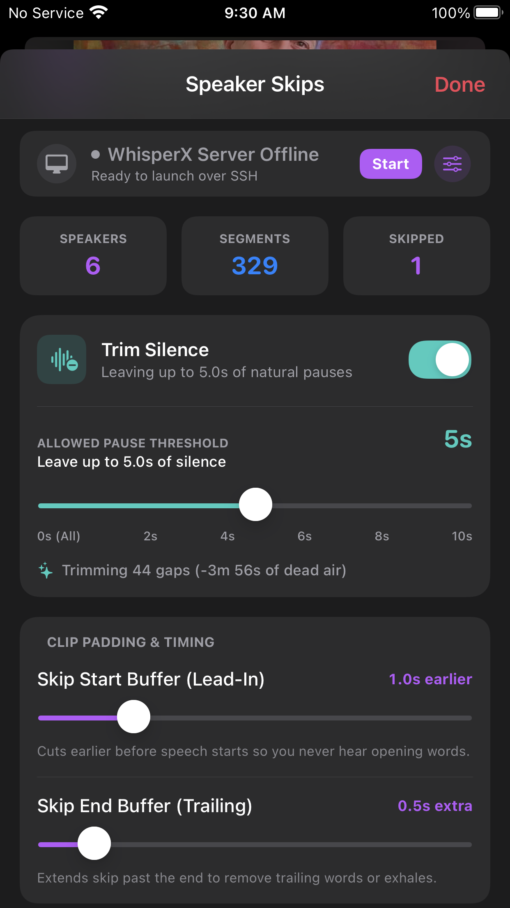
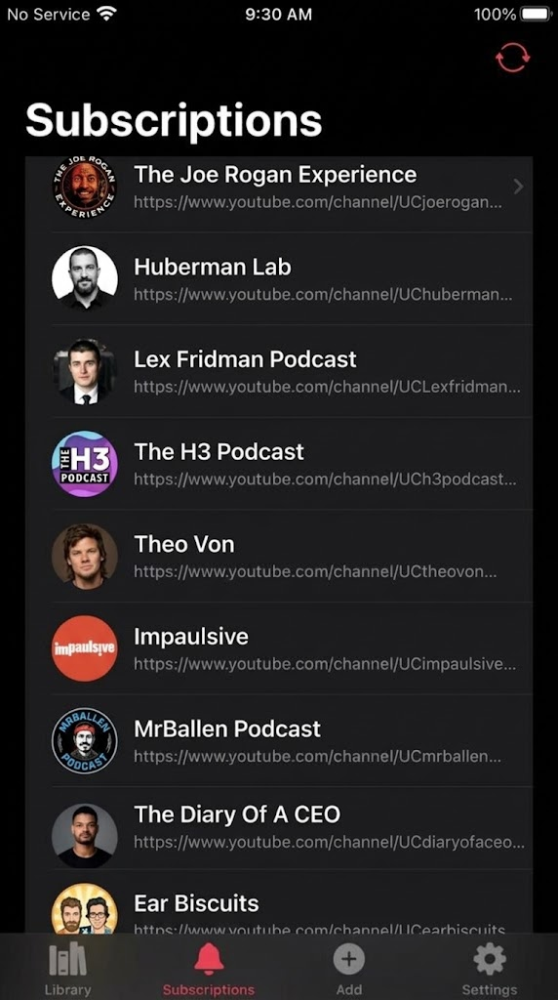
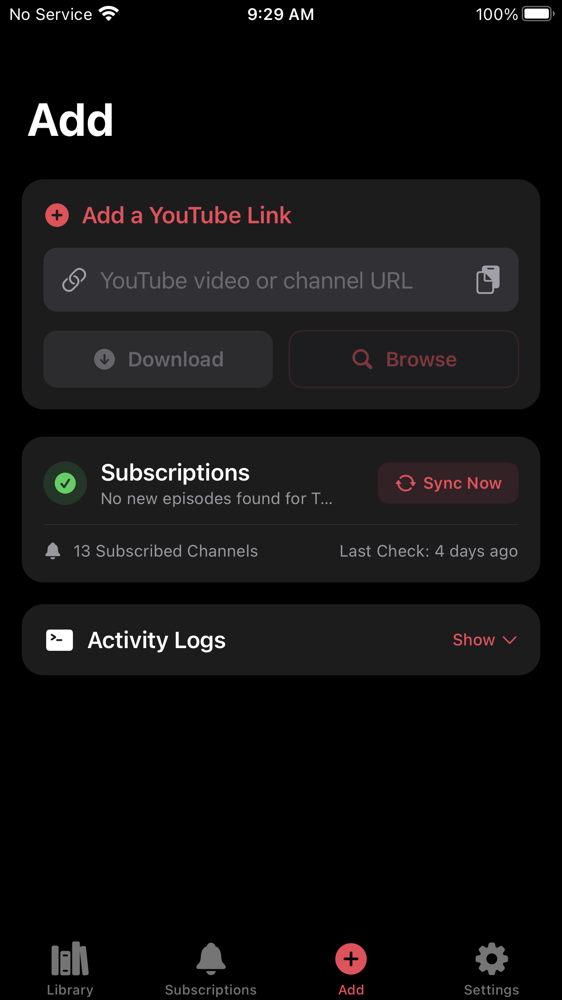
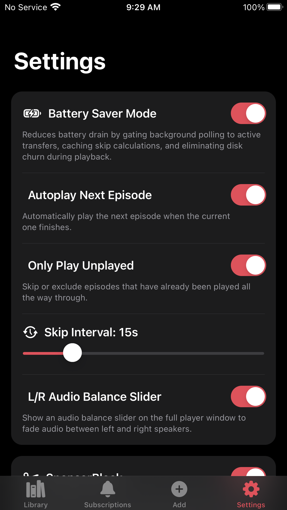
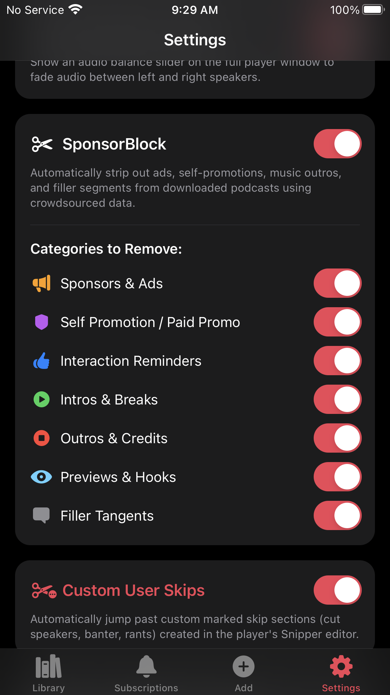
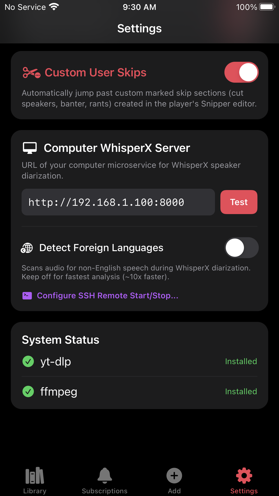

# PodcastThis

PodcastThis is a free, open-source iOS app that turns YouTube channels and single videos into offline, audio-only podcasts. It downloads audio directly to your device with album art and tags, skips ads via SponsorBlock, checks for new episodes in the background without draining your battery, and lets you skip specific speakers using local AI diarization.

---

## Screenshots

| Player | Library | Show Detail |
|---|---|---|
|  |  |  |

| Speaker Skips | Skip Tuning | Subscriptions |
|---|---|---|
|  |  |  |

| Add Episode | Settings | SponsorBlock |
|---|---|---|
|  |  |  |

---

## Features

### Subscriptions and Background Downloads
* **Channel Subscriptions**: Follow YouTube channels to automatically download new episodes as audio files.
* **Single Video Downloads**: Paste a link directly in the app, or send it from Safari or the YouTube app via the native iOS Share Sheet.
* **Battery-Aware Background Daemon**: Runs every 2 hours via launchd (`com.saihgupr.podcastthis`). Downloads pause automatically if your battery is below 25% and unplugged.

### Speaker-Specific Skipping (WhisperX)
* **Skip Individual Speakers**: Connect the companion desktop server to identify distinct voices in an episode.
* **Speaking Breakdown**: View talk time percentages, rename speakers, and toggle individual voices to skip automatically during playback.
* **Skip Tuning**: Adjust pre-roll and post-roll padding, silence trimming, and preview edits in real time.

### SponsorBlock and Custom Skips
* **SponsorBlock**: Strips sponsor segments, intros, outros, and self-promotions using crowdsourced timestamps.
* **Waveform Snipper**: Manually mark and save custom skip regions directly on an episode's audio waveform.

### Native iOS Audio Playback
* **Lock Screen and Control Center**: Integrates with `AVPlayer`, `MPNowPlayingInfoCenter`, and `MPRemoteCommandCenter` for Lock Screen, Control Center, CarPlay, and Bluetooth controls.
* **Playback Controls**: Variable speed from 0.75x to 2.0x, customizable skip intervals, and progress memory per episode.
* **Stereo Balance Slider**: Optional real-time left/right balance slider in Settings using `MTAudioProcessingTap`.

---

## Optional: WhisperX Speaker Diarization

<details>
<summary><b>Computer setup instructions (macOS, Linux, Windows)</b></summary>

<br>

To enable AI speaker diarization and per-speaker skipping, run the companion FastAPI service on your computer or home server:

1. **Hugging Face Token**:
   Create a free account on [Hugging Face](https://huggingface.co), generate an access token, and accept the model conditions for:
   * [pyannote/speaker-diarization-community-1](https://huggingface.co/pyannote/speaker-diarization-community-1)
   * [pyannote/speaker-diarization-3.1](https://huggingface.co/pyannote/speaker-diarization-3.1)
   * [pyannote/segmentation-3.0](https://huggingface.co/pyannote/segmentation-3.0)

2. **Run Setup**:
   ```bash
   cd services/whisperx-service
   chmod +x setup.sh
   ./setup.sh
   ```
   Paste your Hugging Face token when prompted. The script sets up the Python virtual environment, installs dependencies, and prints your local IP.

3. **Start the Service**:
   ```bash
   ./start.sh
   ```

4. **Connect from the App**:
   In **Settings -> Computer WhisperX Server**, enter your computer's IP (e.g. `http://192.168.1.100:8000`) and tap **Test**. You can also enter SSH credentials to start and stop the service directly from the iOS app.



</details>

---

## Installation

### Requirements
* Jailbroken device running iOS 14.0 or newer (tested on iOS 15 and 16, rootless jailbreaks supported)
* Dependencies: `python3` and `ffmpeg` (installed automatically by your package manager)

### Install via .deb
1. Download the latest `com.saihgupr.podcastthis_*.deb` from [GitHub Releases](https://github.com/saihgupr/podcast-this/releases).
2. Open the file in **Sileo** or **Zebra** to install, or copy it to your device and run `dpkg -i <file>.deb` as root over SSH.
3. Respring and open PodcastThis from the Home Screen.

---

## Building from Source

Requires macOS or Linux with [Theos](https://theos.dev):

```bash
git clone https://github.com/saihgupr/podcast-this.git
cd podcast-this
make package
```

The compiled package will be in `packages/`.

---

## Support & Feedback

If you encounter any issues, bugs, or have feature requests, please [open an issue on GitHub](https://github.com/saihgupr/podcast-this/issues).

PodcastThis is open-source and free. If you find it useful, consider giving it a star on GitHub or making a donation to support development!

[](https://ko-fi.com/saihgupr)
